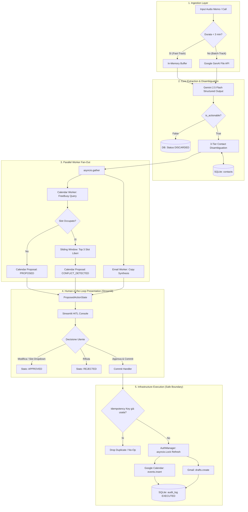

# Master Implementation Plan: Executive Call & Meeting Operations Agent

**Project:** Executive Call & Meeting Operations Agent (Voice-to-Action)  
**Target:** Preparazione & Live Demo Colloquio Tecnico Trellis (Tech Lead / Principal Engineer track)  
**Architecture:** Hexagonal Architecture (Ports & Adapters) con State Machine deterministica e Human-in-the-Loop  
**Location:** `./call_meeting_agent/`  

---

## 1. Goal Description

Sviluppare un agente operativo locale a comando vocale (Voice-to-Action) progettato con standard industriali di alta affidabilità. Il sistema trasforma note vocali e registrazioni di meeting in azioni concrete e atomiche:
1. **Comprensione Multimodale Nativa**: Estrazione di entità, intenzioni e date via Gemini 2.5 Flash Structured Outputs (zero parsing regex).
2. **Contact Memory Graph**: Disambiguazione semantica e relazionale dei contatti a 3 livelli con fallback deterministico.
3. **Fan-Out Concorrente**: Esecuzione parallela disaccoppiata di Calendar Worker (con verifica conflitti FreeBusy) ed Email Worker (stesura bozze contestualizzate).
4. **Execution Boundary Rigido**: Principio del Least Privilege (`drafts.create` su Gmail, zero invio autonomo, `events.insert` differito).
5. **Console Human-in-the-Loop**: Interfaccia Streamlit reattiva per risoluzione guidata dei conflitti (The Trellis Way), editing delle bozze e commit idempotente con un click.
6. **100% Demo Ready**: Pattern di Dependency Injection con Mock Services integrati (`DEMO_MODE=true`) per garantire il funzionamento perfetto anche offline durante il colloquio tecnico.

---

## 2. Architettura di Sistema



---

## 3. Struttura del Progetto (Hexagonal Architecture)

All'interno della radice di progetto:

```text
call_meeting_agent/
├── pyproject.toml                     # Dipendenze deterministiche (uv/poetry standard)
├── .env.example                       # Variabili d'ambiente (GEMINI_API_KEY, DEMO_MODE, ecc.)
├── README.md                          # Guida architetturale per l'intervista
├── src/
│   └── agent/
│       ├── __init__.py
│       ├── domain/                    # DOMINIO PURO (Nessuna dipendenza esterna)
│       │   ├── __init__.py
│       │   ├── enums.py               # ActionStatus, ActionType, IntentCategory
│       │   ├── models.py              # Contratti Pydantic (Session, Action, Contact, Payload)
│       │   └── ports.py               # Python Protocols / ABC (Interfacce astratte)
│       │
│       ├── application/               # CASI D'USO & ORCHESTRAZIONE
│       │   ├── __init__.py
│       │   ├── auth_manager.py        # OAuth2 token lifecycle con asyncio.Lock concurrency
│       │   ├── process_session.py     # Use Case: Ingestion -> Estrazione -> Disambiguazione -> Fan-out
│       │   ├── resolve_conflict.py    # Algoritmo sliding window per trovare slot liberi
│       │   └── commit_action.py       # Use Case: Idempotency check -> Esecuzione sicura -> Audit log
│       │
│       ├── infrastructure/            # ADAPTERS (Implementazioni concrete dei Ports)
│       │   ├── __init__.py
│       │   ├── config.py              # Pydantic BaseSettings (.env loader)
│       │   ├── database/
│       │   │   ├── __init__.py
│       │   │   ├── sqlite_repo.py     # Repository aiosqlite con transazioni ACID
│       │   │   └── schema.sql         # DDL tabelle (contacts, sessions, actions, audit_log)
│       │   ├── llm/
│       │   │   ├── __init__.py
│       │   │   ├── gemini_adapter.py  # Ingestion nativa + Structured Outputs + Tenacity backoff
│       │   │   └── mock_llm.py        # LLM deterministico per demo offline
│       │   └── google/
│       │       ├── __init__.py
│       │       ├── calendar_adapter.py# Google Calendar Client reale
│       │       ├── gmail_adapter.py   # Gmail Drafts Client reale
│       │       └── mock_google.py     # Mock Calendar (con overbooking simulato) & Mock Gmail
│       │
│       └── presentation/              # INTERFACCIA UTENTE
│           ├── __init__.py
│           ├── app.py                 # Entry point Streamlit
│           ├── components/
│           │   ├── audio_player.py    # Player con waveform/playback
│           │   ├── conflict_card.py   # Banner Warning con dropdown Top 3 slot alternativi
│           │   ├── email_card.py      # Live editor per il corpo email
│           │   └── audit_table.py     # Storico delle transazioni eseguite
│           └── styles.css             # UI styling personalizzato e moderno
│
└── tests/                             # SUITE PYTEST (100% Deterministica e veloce)
    ├── __init__.py
    ├── conftest.py                    # Fixture isolate con database in memoria (:memory:)
    ├── test_state_machine.py          # Verifica transizioni di stato e idempotenza
    ├── test_conflict_resolution.py    # Test algoritmo sliding window su FreeBusy
    ├── test_auth_concurrency.py       # Test unitario del race condition lock su token refresh
    └── test_escape_hatch.py           # Verifica no-op su audio privo di impegni
```

---

## 4. Specifiche Tecniche dei Componenti

### 4.1 Domain Layer: Modelli Pydantic & Contratti
```python
# src/agent/domain/enums.py
from enum import Enum

class ActionStatus(str, Enum):
    PROPOSED = "PROPOSED"
    CONFLICT_DETECTED = "CONFLICT_DETECTED"
    APPROVED = "APPROVED"
    EXECUTED = "EXECUTED"
    EXECUTION_FAILED = "EXECUTION_FAILED"
    REJECTED = "REJECTED"
    DISCARDED = "DISCARDED"

class ActionType(str, Enum):
    CALENDAR_EVENT = "CALENDAR_EVENT"
    EMAIL_DRAFT = "EMAIL_DRAFT"

class IntentCategory(str, Enum):
    BUSINESS_MEETING = "BUSINESS_MEETING"
    FOLLOW_UP = "FOLLOW_UP"
    CHITCHAT_NOOP = "CHITCHAT_NOOP"
```

```python
# src/agent/domain/models.py
from pydantic import BaseModel, Field, EmailStr
from datetime import datetime
from typing import List, Optional
from .enums import ActionStatus, ActionType, IntentCategory

class Contact(BaseModel):
    id: str
    first_name: str
    last_name: str
    email: EmailStr
    company: str
    role: str
    aliases: List[str] = Field(default_factory=list)
    tags: List[str] = Field(default_factory=list)
    timezone: str = "Europe/Rome"

class ExtractedEntity(BaseModel):
    raw_name: str
    context_clues: List[str] = Field(default_factory=list)
    matched_contact_id: Optional[str] = None
    is_ambiguous: bool = False
    candidate_ids: List[str] = Field(default_factory=list)

class CalendarPayload(BaseModel):
    title: str
    start_utc: datetime
    end_utc: datetime
    attendees: List[str]
    description: str
    location: Optional[str] = "Google Meet"
    alternative_slots_utc: List[datetime] = Field(default_factory=list)

class EmailPayload(BaseModel):
    recipient_email: str
    recipient_name: str
    subject: str
    body_markdown: str
    cc: List[str] = Field(default_factory=list)

class ProposedAction(BaseModel):
    id: str
    session_id: str
    action_type: ActionType
    status: ActionStatus
    calendar_data: Optional[CalendarPayload] = None
    email_data: Optional[EmailPayload] = None
    idempotency_key: str
    created_at: datetime
    updated_at: datetime

class SessionExtractionResult(BaseModel):
    session_id: str
    is_actionable: bool
    intent_category: IntentCategory
    summary: str
    raw_transcript: str
    entities: List[ExtractedEntity] = Field(default_factory=list)
    proposed_actions: List[ProposedAction] = Field(default_factory=list)
```

### 4.2 Ports Layer: Interfacce Astratte (Python Protocols)
```python
# src/agent/domain/ports.py
from typing import Protocol, List, Optional
from datetime import datetime
from .models import SessionExtractionResult, ProposedAction, Contact, CalendarPayload, EmailPayload

class LLMExtractorPort(Protocol):
    async def extract_from_audio(self, audio_bytes: bytes, filename: str, anchor_utc: datetime) -> SessionExtractionResult: ...

class CalendarServicePort(Protocol):
    async def check_freebusy(self, start_utc: datetime, end_utc: datetime) -> bool: ...
    async def find_alternative_slots(self, requested_start_utc: datetime, duration_minutes: int, count: int = 3) -> List[datetime]: ...
    async def create_event(self, payload: CalendarPayload, idempotency_key: str) -> str: ...

class EmailServicePort(Protocol):
    async def create_draft(self, payload: EmailPayload, idempotency_key: str) -> str: ...

class RepositoryPort(Protocol):
    async def get_contacts(self) -> List[Contact]: ...
    async def save_session(self, session: SessionExtractionResult) -> None: ...
    async def update_action_status(self, action_id: str, new_status: str, diff_payload: Optional[dict] = None) -> None: ...
    async def is_idempotency_key_used(self, key: str) -> bool: ...
```

---

## 5. Algoritmo di Risoluzione Conflitti (The Trellis Way)

Nel dominio dei PMS per affitti brevi gestito da Trellis, il rilevamento e la gestione dei conflitti di calendario è un requisito fondamentale per evitare l'overbooking. Il nostro `resolve_conflict.py` applica una logica deterministica su finestre temporali:

1. **Query FreeBusy**: Interroga l'intervallo temporale richiesto $[T_{start}, T_{end}]$ su Google Calendar.
2. **Se Libero**: Lo stato dell'azione viene marcato come `PROPOSED`.
3. **Se Occupato (Collisione)**:
   - Lo stato dell'azione diventa `CONFLICT_DETECTED`.
   - L'algoritmo esegue una scansione a finestra scorrevole (sliding window) a step di 30 minuti nelle 48 ore successive durante i working hours configurati (es. 09:00 - 18:00 UTC).
   - Calcola i **Top 3 slot alternativi contigui** disponibili.
   - Popola il campo `alternative_slots_utc` nel payload dell'azione.
4. **Presentazione HITL**: La console Streamlit evidenzia graficamente l'allerta di overbooking e fornisce un selettore a tendina con gli slot alternativi. L'utente sceglie con un click, lo stato passa ad `APPROVED`, e solo allora è consentito il commit.

---

## 6. Concurrency-Safe AuthManager (Race Condition Shield)

Quando i worker di Calendar ed Email vengono eseguiti in parallelo via `asyncio.gather`, entrambi potrebbero intercettare contemporaneamente la scadenza del token OAuth2 (HTTP 401).

```python
# src/agent/application/auth_manager.py
import asyncio
from typing import Optional

class AuthManager:
    def __init__(self, token_store):
        self._token_store = token_store
        self._refresh_lock = asyncio.Lock()
        self._access_token: Optional[str] = None
        self._expiry_timestamp: float = 0.0

    async def get_valid_token(self) -> str:
        # Fast path senza lock se il token è ancora valido
        if self._access_token and not self._is_expired():
            return self._access_token

        # Protezione concorrenza: solo un worker esegue la chiamata di refresh
        async with self._refresh_lock:
            # Double-check: un altro worker potrebbe aver appena rinfrescato il token
            if self._access_token and not self._is_expired():
                return self._access_token

            # Chiamata sicura verso Google Identity Provider
            new_token, new_expiry = await self._perform_google_refresh()
            self._access_token = new_token
            self._expiry_timestamp = new_expiry
            return self._access_token
```

---

## 7. Deterministic Demo Mode (Demo Readiness)

Per permettere l'esecuzione e il collaudo anche in ambienti isolati:
- Configurando `DEMO_MODE=true` nel file `.env`, la Dependency Injection carica:
  1. `MockLLM`: Restituisce un payload realistico relativo a una call su quote, commissioni e calendari con contatti noti.
  2. `MockCalendarService`: Simula intenzionalmente un conflitto sull'orario richiesto per mostrare a Filippo il banner di Warning e la risoluzione automatica delle alternative libere.
  3. `MockEmailService`: Crea la bozza in memoria e registra l'idempotency key nell'audit log di SQLite.

---

## 8. Piano di Verifica (Pytest & Manuale)

### 8.1 Automated Unit Tests (`pytest -v`)
1. **`test_state_machine.py`**:
   - Transizione corretta da `PROPOSED` ad `APPROVED` e infine ad `EXECUTED`.
   - Verifica che un'azione in `CONFLICT_DETECTED` non possa passare a `EXECUTED` senza una selezione slot esplicita.
   - Verifica che un secondo commit con la stessa `idempotency_key` venga scartato silenziosamente senza duplicati.
2. **`test_escape_hatch.py`**:
   - Inserimento di una trascrizione priva di impegni -> Verifica dello stato `DISCARDED` e assenza di chiamate ai worker.
3. **`test_conflict_resolution.py`**:
   - Simulazione di intervalli occupati -> Verifica del calcolo corretto dei 3 slot alternativi liberi.
4. **`test_auth_concurrency.py`**:
   - Esecuzione di 10 task asincroni concorrenti che richiedono il token simultaneamente -> Verifica che venga eseguita esattamente 1 sola richiesta di refresh.

### 8.2 Live Manual Demo Workflow (Per l'intervista con Filippo)
1. **Lancio dell'applicazione**: `streamlit run src/agent/presentation/app.py`
2. **Caricamento Audio di Prova**: Selezionare una nota vocale di prova inclusa nel repo (`sample_call_filippo.mp3` o simulazione con Mock).
3. **Ispezione Visiva**:
   - L'audio viene riprodotto nel player HTML5.
   - Appare il riassunto esecutivo con le entità estratte e il loro ruolo.
   - Visualizzazione della card di **Conflitto Calendario** con lo slot occupato evidenziato in giallo.
   - Selezione di uno slot alternativo dal menu a tendina.
   - Revisione del testo della bozza email nell'editor incorporato.
4. **One-Click Commit**: Pressione del tasto "Approve & Execute" -> Notifica di successo immediata, aggiornamento dell'audit log in tempo reale e dimostrazione dell'idempotenza cliccando una seconda volta.
