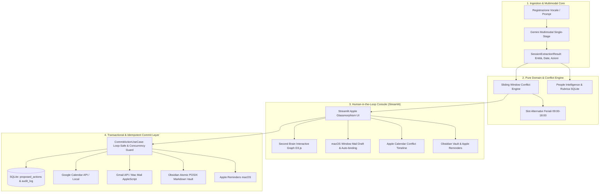

# 🎙️ Aria — Executive Call & Meeting Operations Agent

> **Enterprise Voice-to-Action Executive Assistant**  
> Progettato con standard industriali di alta affidabilità, **Architettura Esagonale (Ports & Adapters)** pura, gestione deterministica della concorrenza e Second Brain interattivo con **D3.js**.

---

## 🏛️ Architettura di Sistema

Aria trasforma registrazioni vocali o note d'incontro in flussi operativi atomici, sicuri e tracciati senza mai eseguire azioni irreversibili senza il consenso esplicito dell'utente (*Human-in-the-Loop*).



---

## 🛡️ Pilastri Ingegneristici

### 1. Idempotenza a 2 Fasi e Blindatura Concorrente Multi-Loop
- **Chiave Deterministica SHA-256**: Generata univocamente da `session_id + action_type + action_id`.
- **Protezione Anti-Doppio Click (TOCTOU)**: Lock asincrono cooperativo isolato per coppia `(event_loop, idempotency_key)`, garantendo immunità totale a `RuntimeError: ... bound to a different event loop` durante i rerun di Streamlit.
- **Transazionalità e Resilienza su Retry**: In caso di errore dell'adapter esterno (es. timeout di rete 503), l'azione viene marcata `EXECUTION_FAILED` nell'Audit Log SQLite senza corrompere il database e **senza bloccare un successivo retry legittimo** con la stessa chiave.

### 2. Risoluzione Intelligente dei Conflitti di Calendario
- Scansione temporale a finestra scorrevole (*Sliding Window* a passi di 30 minuti).
- Proiezione multi-fuso orario automatica (fallback deterministico su `Europe/Rome`).
- Rispetto rigoroso dei giorni feriali (salto automatico del weekend) e delle working hours (09:00 - 18:00).

### 3. Second Brain Obsidian & Interactive D3.js Force Graph
- **Scrittura Atomica POSIX**: Aggiornamento delle note meeting e dossier contatti tramite file temporaneo `.md.tmp` e rename atomico, preservando il frontmatter YAML e prevenendo corruzioni di filesystem.
- **Grafo Relazionale Interattivo (D3.js v7)**: Visualizzazione force-directed su SVG con Zoom & Pan fluido, Drag & Drop dei nodi, Tooltip fluttuanti in stile macOS e anello ambra pulsante (*"In attesa di sync"*) che transita a verde solido (*"Sincronizzato nel Vault"*) al momento del commit.

### 4. Esperienza Email Senza Destinatario & Rubrica Rapida
- Gestione non-bloccante di contatti senza indirizzo email (es. "Mamma" o memo personali): creazione legittima della bozza aperta su Apple Mail o Gmail senza errori di sintassi.
- Auto-binding rubrica e memorizzazione automatica dell'indirizzo digitato nel dossier contatto SQLite.

---

## ⚡ Quickstart

### 1. Requisiti & Setup
```bash
# Attiva il tuo ambiente Python (Python 3.10+)
conda activate py313  # o virtualenv dedicato

# Installa le dipendenze
pip install -r requirements.txt
```

### 2. Esecuzione Test Suite ad Alta Affidabilità
La suite comprende **22 test deterministici** isolati su memoria e `tmp_path` (0 chiamate di rete esterne, 0 popup di sistema, esecuzione in < 0.2s):
```bash
pytest -v
```

### 3. Avvio della Console Operativa
```bash
streamlit run src/agent/presentation/app.py
```
Accedi su `http://localhost:8501`.

---

## 📁 Struttura del Progetto

```text
call_meeting_agent/
├── pyproject.toml              # Configurazione packaging PEP-621 e pytest asyncio
├── requirements.txt            # Dipendenze pinatte di runtime e test
├── data/
│   ├── call_agent.db           # Database SQLite locale (contatti, sessioni, audit_log)
│   └── vault/                  # Second Brain Obsidian locale (contacts/, meetings/)
├── src/agent/
│   ├── domain/                 # Entità pure immutabili, Pydantic models e datetime_utils
│   ├── application/            # Casi d'uso: ProcessSessionUseCase, CommitActionUseCase, ResolveConflict
│   ├── infrastructure/         # Adapter: Google Live, Obsidian Vault, SQLite Repo, Gemini, Apple Reminders
│   └── presentation/           # Streamlit HITL UI, D3.js Graph View, CSS Design System Apple
└── tests/                      # Suite di 22 test automatizzati (contratti, conflitti, vault, idempotenza)
```
